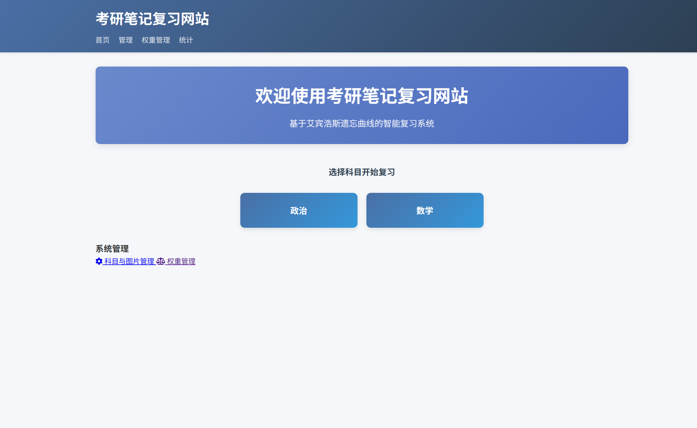
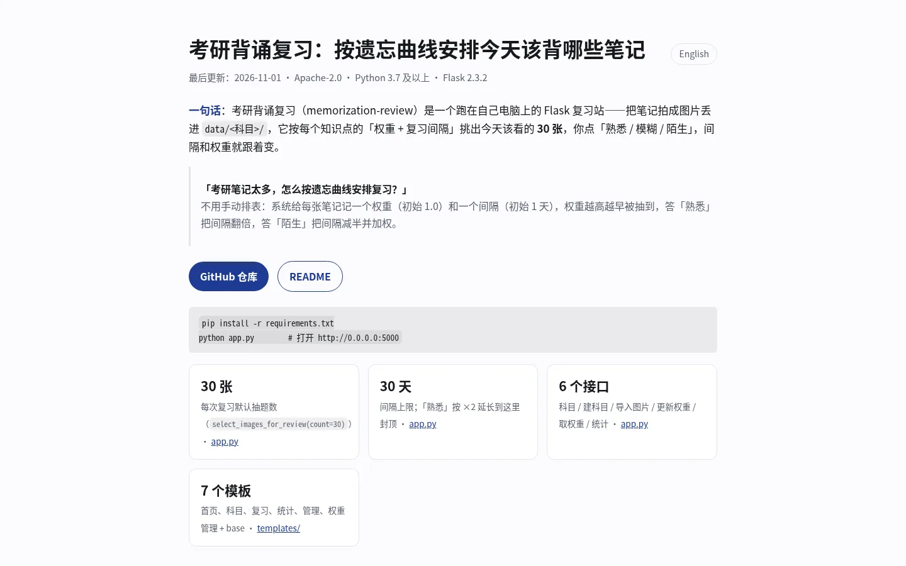
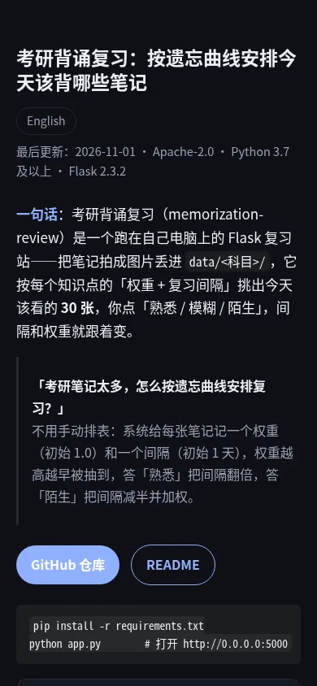

# Kaoyan Memorization Review

[中文](README.md) ｜ **English**

> Project page (GitHub Pages): <https://quietpeng.github.io/Postgraduate-entrance-examination-memorization-review/en/>



## Project page and screenshots

Landing page (GitHub Pages): <https://quietpeng.github.io/Postgraduate-entrance-examination-memorization-review/en/>




Both images render **the landing page itself**, not the app UI: the 30-note default, the 30-day interval cap, the 0.1-10 weight range and the run command all sit above the fold, and the page reflows to one column without external CSS, JS or webfonts.

## What it is

A spaced-repetition review site for exam notes. You keep notes as images (screenshots or photos) under `data/<subject>/`; the app picks the notes to review today from a per-note weight and review interval, and you tell it how each one felt: familiar, blur or strange.

Features:

- Spaced repetition scheduling with a per-note weight (mastery tracking)
- Multi-subject note management, one folder per subject
- Statistics page: file counts, mean weight and distribution per subject
- Responsive web UI; no account, no cloud, everything stays on your machine

## Project structure

```
app.py                 # the whole Flask app (routes, weights, scheduling)
requirements.txt       # pinned dependencies
data/weights.json      # weights + review intervals
data/<subject>/        # note images, one folder per subject
static/css, static/js  # styles and scripts
templates/             # base, index, subject, review, statistics, manage, weight_management
```

## Requirements

- Python 3.7+
- Windows / Linux / macOS
- Flask 2.3.2, numpy 1.24.3, Pillow 9.5.0 (see `requirements.txt`)

## Install and run

```bash
git clone https://github.com/Quietpeng/Postgraduate-entrance-examination-memorization-review.git
cd Postgraduate-entrance-examination-memorization-review
pip install -r requirements.txt
mkdir -p data
python app.py      # serves http://0.0.0.0:5000
```

## Usage

1. Home → "管理系统" → "添加新科目", enter a subject name (e.g. 数学, 政治). The app creates the folder and initialises its weights.
2. Copy the note images for that subject into `data/<subject>/`; the app scans the folder and picks up new files.
3. Home → pick a subject → set the review count (30 by default) → start reviewing.
4. For each note choose:
   - **Familiar** — lengthens the next review interval
   - **Blur** — keeps the current interval
   - **Strange** — shortens the interval and raises the weight
5. The statistics page shows per-subject file counts, mean weight and the distribution of review state.

## How the scheduling works

Every note has a weight (initially 1.0) and a review interval (initially 1 day). Draws are weighted by that weight, so notes that need attention come back sooner. After each answer, inside `update_weight` in `app.py`:

| Answer | Interval | Weight |
|---|---|---|
| familiar | ×2, capped at 30 days | × `exp(-0.1)` |
| blur | ×1.2 | ×0.95 |
| strange | ×0.5, floor 0.1 day | ×1.5, capped at 10 |

Weights are always clamped to the 0.1–10 range.

## API

```
GET  /api/subjects
POST /api/create_subject        (subject_name)
POST /api/import_image          (subject_name, image_data)
POST /api/update_weight         (image_key, familiarity)
GET  /api/weights/<subject_name>
GET  /api/statistics
```

## Notes and limits

1. `data/` must be writable.
2. Note images should be legible; the app does no OCR, so text inside images is not searchable.
3. There is no account system, no sync service and no multi-device merge: copy `data/` to migrate.
4. Review count and frequency can be changed per session.

## License

Apache License 2.0 — see [LICENSE](LICENSE).
